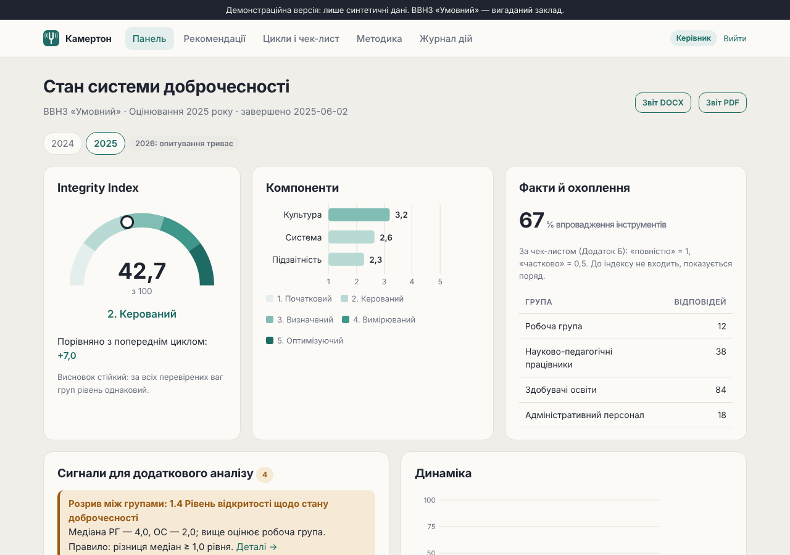

# Камертон

Команда: «[НАЗВА КОМАНДИ — вписати]» · Завдання 3. Integrity Management Dashboard

## Проблема і користувач

Користувачі — керівник вищого військового навчального закладу та уповноважена особа з питань запобігання та виявлення корупції. Щороку вони мають оцінити рівень зрілості системи доброчесності: провести анкетування робочої групи й особового складу, звести сотні паперових відповідей, порахувати показники й підготувати звіт. Нині це робиться вручну, займає тижні й дає результат, який важко порівняти з минулим роком і важко перевірити. Через це оцінювання перетворюється на формальність, а слабкі місця, як-от розрив між тим, що бачить керівництво, і тим, що відчувають викладачі та курсанти, лишаються непоміченими. Камертон робить оцінювання анонімним, швидким і відтворюваним, а результати перетворює на конкретні заходи з відповідальними та строками.

## Що робить рішення

- **Анонімне опитування за одноразовими кодами.** Уповноважена особа створює цикл, друкує аркуш карток із QR-кодами й роздає їх. Респондент сканує QR телефоном і одразу потрапляє в анкету. Код не пов'язаний з людиною, а відповідь не пов'язана з кодом.
- **Автоматичний розрахунок Integrity Index (0–100) і рівня зрілості** для кожного компонента («Культура», «Система», «Підзвітність») і кожного питання за відкритою методикою.
- **Сигнали для додаткового аналізу.** Камертон позначає розрив між оцінками робочої групи й особового складу, завищену самооцінку та розбіжність між відповідями й чек-листом впровадження інструментів. Групи, менші за 5 осіб, приховуються.
- **Панель керівника.** Індекс, компоненти, динаміка за три роки, порівняння «робоча група проти особового складу», сильні й слабкі сторони з переходом до кожного питання.
- **Рекомендації з Додатка Д.** Система пропонує заходи за явними правилами, а керівник ухвалює або відхиляє їх, призначає відповідального й строк і відстежує виконання.
- **Звіт за формою Додатка Г** у форматах DOCX і PDF, сформований одним натисканням.
- **Журнал дій і сторінка результатів для учасників опитування**, щоб особовий склад бачив, що його відповіді вплинули на рішення.



## Демонстрація

- Відео (до 3 хв): [ПОСИЛАННЯ — додати до 23.11]
- Робоча версія: https://camerton.onrender.com — демо-вхід за ролями без пароля, лише синтетичні дані. Безкоштовний хостинг засинає після 15 хвилин без звернень, тому перше відкриття може тривати до хвилини.

## Як запустити

Заздалегідь встановити: Python 3.11 або новіший, Git.

```bash
git clone https://github.com/donduvs/camerton.git
cd camerton
pip install -r requirements.txt
uvicorn app.main:app --no-access-log
```

Відкрити в браузері http://127.0.0.1:8000. Під час першого запуску база створюється автоматично й заповнюється синтетичними даними за 2024–2026 роки.

## Як влаштовано

**Стек:** Python, Starlette, uvicorn, шаблони Jinja2, SQLite. Діаграми — SVG, які генерує сам застосунок, без зовнішніх бібліотек. Звіти — python-docx і ReportLab. QR-коди — ReportLab.

**Схема компонентів**

```
Респондент (телефон) ──QR/код──▶ Опитування ──▶ responses (без коду, часу, IP)
                                                     │
Налаштування data/*.json ──▶ Розрахунковий модуль (app/engine.py)
                                                     │
                     ┌───────────────┬───────────────┼───────────────┐
                     ▼               ▼               ▼               ▼
              Панель керівника  Рекомендації   Звіт DOCX/PDF    API (JSON)
```

**Де лежить основна логіка**

| Файл | Що робить |
|---|---|
| `app/engine.py` | рівні зрілості, Integrity Index, сигнали, рекомендації |
| `app/main.py` | маршрути, ролі, цикли, опитування, API |
| `app/db.py` | структура бази й анонімне зберігання |
| `app/report.py` | звіт за формою Додатка Г |
| `app/codes_pdf.py` | аркуш одноразових кодів із QR |
| `app/charts.py` | діаграми SVG |
| `data/*.json` | анкети, чек-лист, заходи, ваги й пороги — змінюються без правки коду |

**Правила, які ухвалюють висновки.** Усі висновки формуються за явними правилами, штучний інтелект у розрахунках і висновках не використовується.

1. Рівень питання для групи — медіана відповідей. Особовий склад — середнє медіан трьох підгруп (НПП, здобувачі освіти, адміністративний персонал) з рівними частками.
2. Рівень питання = 0,3 × робоча група + 0,7 × особовий склад.
3. Рівень компонента — середнє його питань. Integrity Index — середнє трьох компонентів, переведене у шкалу 0–100.
4. Досягнутий рівень зрілості — ціла частина розрахованого значення: рівень вважається досягнутим лише тоді, коли його повністю підтверджено.
5. Сигнали: розрив між групами ≥ 1 рівня; самооцінка вища за досягнутий рівень на ≥ 1; рівень ≥ 3 за питанням, коли відповідний пункт чек-листа має статус «підлягає впровадженню»; група менша за 5 осіб не показується.
6. Стійкість висновку перевіряється за ваг 50/50, 30/70 і «лише особовий склад».
7. Рекомендації система лише пропонує, остаточне рішення ухвалює керівник, і воно фіксується в журналі дій.

Докладно — у `docs/metodyka.md` і на сторінці «Методика» в самому застосунку.

## Документація

Відповідність пунктам «Очікуваного формату кінцевого продукту» завдання 3:

| № | Пункт завдання | Де |
|---|---|---|
| 1 | Робочий прототип | цей репозиторій, робоча версія за посиланням вище |
| 2–5 | Проходження оцінювання, розрахунок Integrity Index, панель керівника, рекомендації | `docs/demonstratsiia.md` — демонстраційний сценарій з числами й знімками екрана |
| 6 | Механізм захисту анонімності | `docs/anonimnist.md` — як респондента неможливо пов'язати з відповіддю |
| 7 | Зіставлення самооцінювання з об'єктивними показниками | `docs/demonstratsiia.md`, розділ 7 — три види зіставлення на прикладах |
| 8 | Розрахунок економії часу | `docs/ekonomiia-chasu.md` — порівняння ручного процесу з Камертоном за операціями |
| 9 | Карта інтеграції | `docs/karta-intehratsii.md` — на базі яких систем працює модуль і які дані бере |
| 10 | Аналіз можливих зловживань | `docs/zlovzhyvannia.md` — ризики й запобіжники |
| 11 | Записка «Як ми використали ШІ» | `docs/ai.md` |
| 12 | Концепція інтеграції з іншими рішеннями у сфері доброчесності | `docs/kontseptsiia-intehratsii.md` — принципи, потоки даних, етапи |

Також:

- `docs/metodyka.md` — методика розрахунку індексу, рівнів, сигналів і рекомендацій з обґрунтуванням ваг.
- `docs/arkhitektura.md` — схема компонентів і відповідність модулям із завдання.
- `docs/api.md` — опис API для інтеграції.
- `docs/posibnyk-korystuvacha.docx` — посібник користувача для всіх ролей.
- `docs/img/` — знімки екрана й варіанти логотипа.

## Що використали

- [Starlette](https://www.starlette.io/) (BSD-3), [uvicorn](https://www.uvicorn.org/) (BSD-3), [Jinja2](https://jinja.palletsprojects.com/) (BSD-3), [itsdangerous](https://itsdangerous.palletsprojects.com/) (BSD-3), [python-multipart](https://github.com/Kludex/python-multipart) (Apache-2.0), [python-docx](https://github.com/python-openxml/python-docx) (MIT), [ReportLab](https://www.reportlab.com/) (BSD).
- Шрифти [DejaVu](https://dejavu-fonts.github.io/) — ліцензія в `app/fonts/LICENSE-DejaVu.txt`.
- Анкети, чек-лист, форма звіту й перелік заходів — з матеріалів завдання 3 (додатки А–Д).
- Модель ШІ Claude (Anthropic) — допомога в аналізі завдання й написанні коду, деталі в `docs/ai.md`. Усі дані в репозиторії синтетичні.
