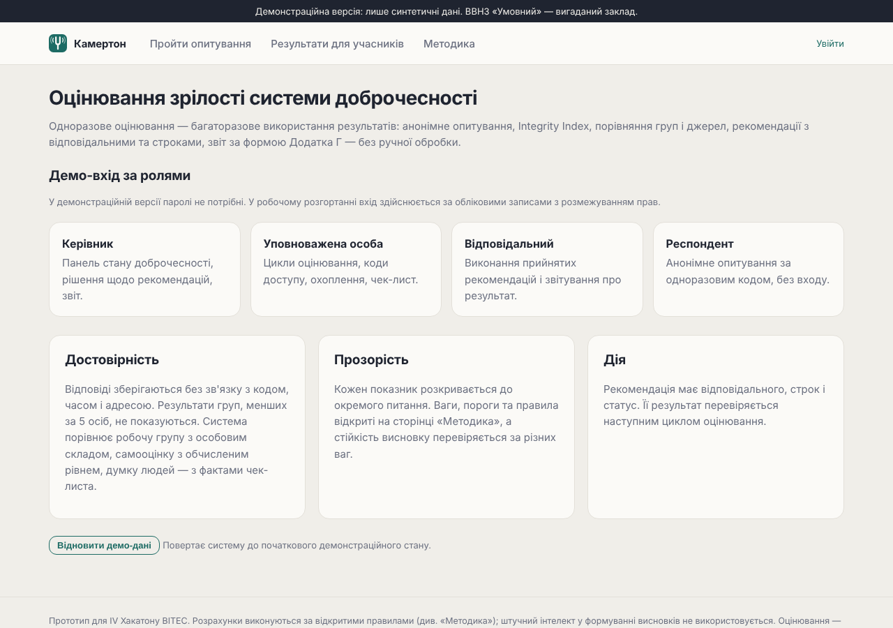
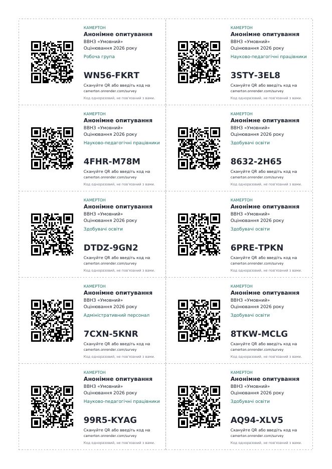
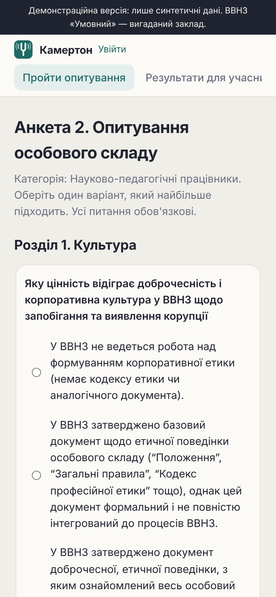
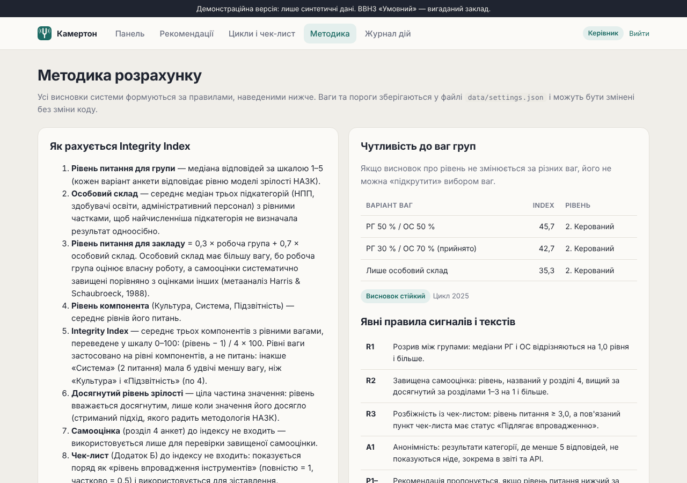
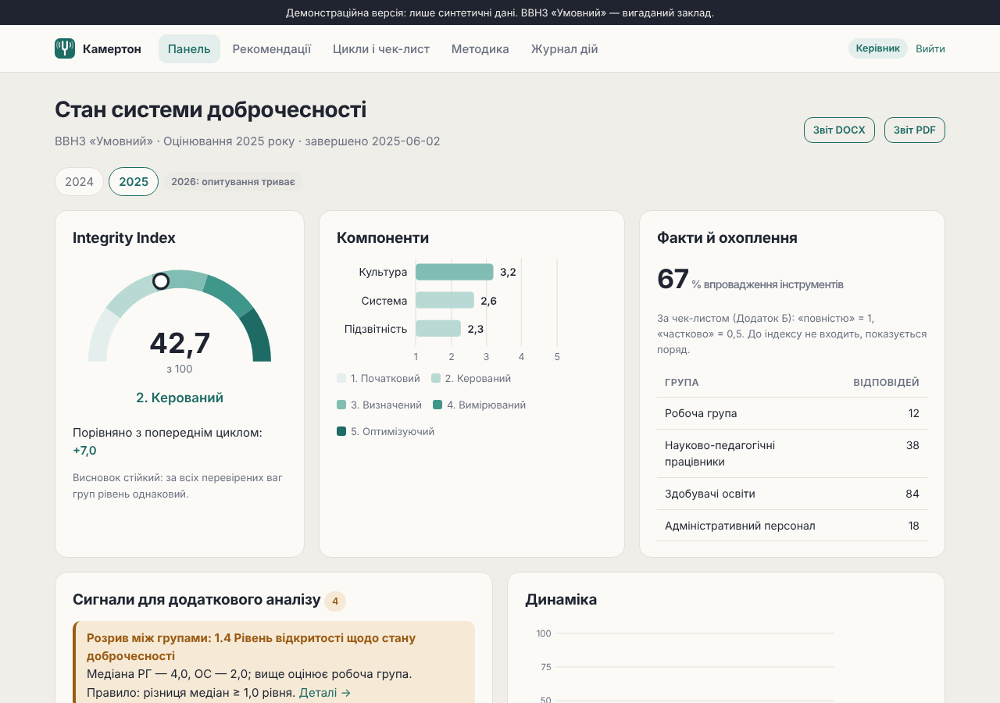
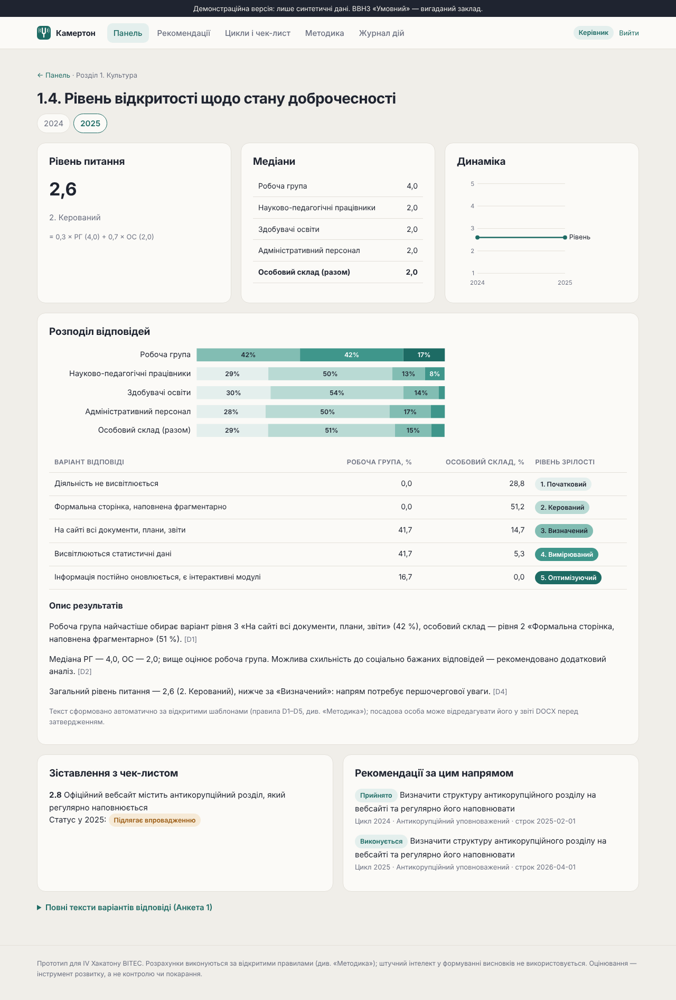
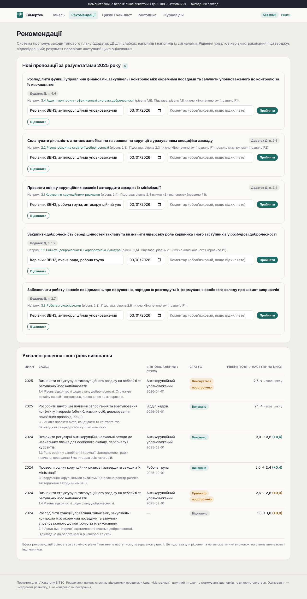
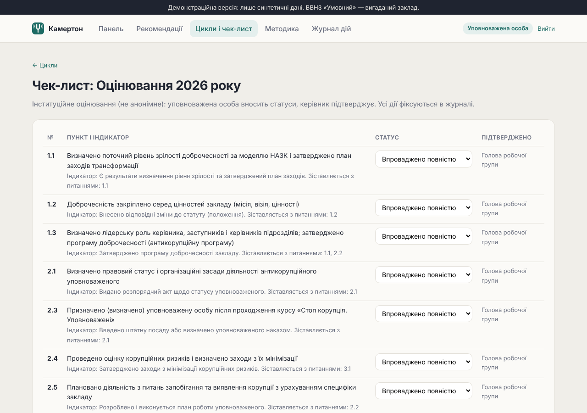
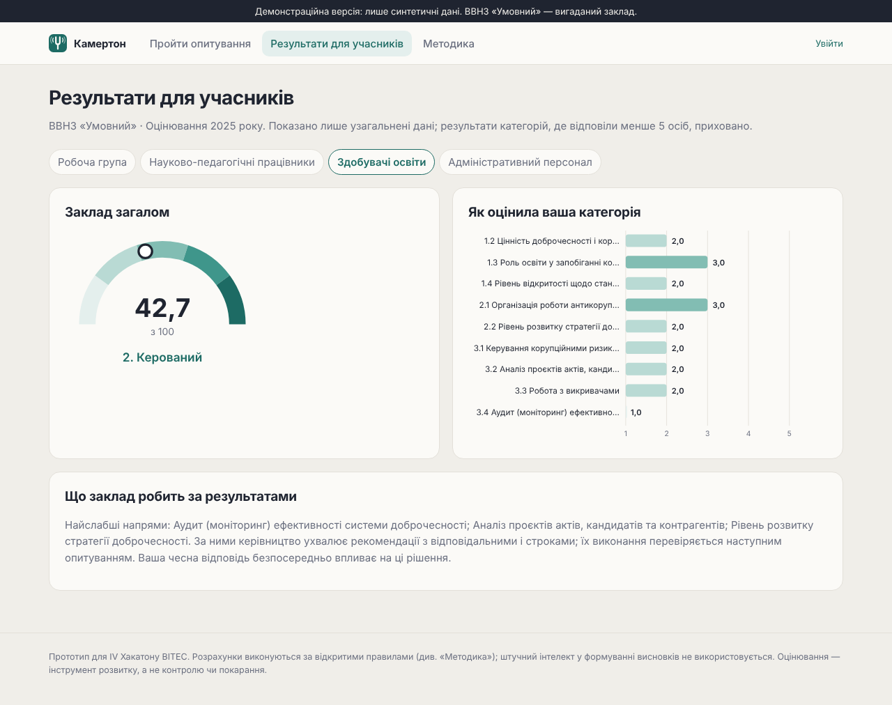

# Демонстраційний сценарій

Документ показує пункти 1–5 і 7 очікуваного формату кінцевого продукту на синтетичних даних вигаданого закладу «ВВНЗ «Умовний»». Усі числа нижче можна перевірити в робочій версії: https://camerton.onrender.com. Демо-дані однакові після кожного відновлення.

## 1. Робочий прототип

Вебзастосунок з чотирма ролями: керівник, уповноважена особа, відповідальний за виконання заходів і респондент. Вхід у демо-версії — кнопками на головній сторінці.

## 2. Проходження оцінювання

1. Уповноважена особа на сторінці «Цикли і чек-лист» створює цикл, задає кількість кодів для кожної категорії й завантажує аркуш для друку.
2. Картки розрізають і роздають так, щоб ніхто не знав, кому дістався який код.
3. Респондент сканує QR телефоном, і анкета відкривається одразу. Можна також ввести код вручну на сторінці «Пройти опитування».
4. Анкета 1 (робоча група) або Анкета 2 (особовий склад) підбирається автоматично за категорією коду. Система не приймає анкету, доки не дано відповідь на всі питання.

## 3. Автоматичний розрахунок Integrity Index

Оцінювання 2025 року, ваги РГ/ОС 30/70:

| Показник | Значення |
|---|---|
| Культура | 3,20 |
| Система | 2,65 |
| Підзвітність | 2,28 |
| Середнє компонентів | 2,71 |
| Integrity Index | (2,71 − 1) / 4 × 100 = 42,7 |
| Досягнутий рівень | 2. Керований |

Аналіз чутливості: за ваг 50/50 індекс становить 45,7, за оцінками лише особового складу — 35,3. В усіх трьох варіантах рівень «Керований», тож висновок позначено як стійкий. Як рахується кожен крок, описано в [metodyka.md](metodyka.md).

## 4. Панель керівника

Один екран: індекс і рівень, компоненти, охоплення опитуванням, сигнали, динаміка за завершені цикли (2024 — 35,7, 2025 — 42,7; цикл 2026 року ще триває), порівняння робочої групи з особовим складом, сильні та слабкі сторони. З кожного показника можна перейти до окремого питання й розподілу відповідей.

## 5. Автоматично сформовані рекомендації

За 2025 рік система запропонувала 7 заходів з Додатка Д. Кожна рекомендація має підставу, тобто правило, за яким вона з'явилась. Приклади:

| Питання | Рівень | Захід | Підстава |
|---|---|---|---|
| 3.4 Аудит ефективності | 1,8 | D4.4 Розподілити функції управління фінансами, закупівель і контролю між окремими посадами | P1: рівень нижче «Визначеного» |
| 2.2 Стратегія доброчесності | 2,3 | D2.5 Спланувати діяльність із запобігання корупції з урахуванням специфіки закладу | P1, а також P2: розрив між групами |
| 1.4 Відкритість | 2,6 | D2.8 Визначити структуру антикорупційного розділу на вебсайті й регулярно його наповнювати | P1, а також P2: розрив між групами |

Керівник приймає рекомендацію (призначає відповідального й строк) або відхиляє її із зазначенням причини. Обидва рішення фіксуються в журналі дій. Відповідальний оновлює статус виконання, а в наступному циклі видно, як змінився рівень питання.

## 7. Зіставлення самооцінювання з об'єктивними показниками

Камертон зіставляє відповіді з трьома джерелами.

**Між категоріями респондентів (сигнал R1).** У 2025 році за питанням 1.4 «Відкритість щодо стану доброчесності» медіана робочої групи становить 4, а всіх трьох підгруп особового складу — 2. Робоча група бачить стан відкритості значно кращим, ніж ті, для кого ця відкритість призначена.

**Із загальною самооцінкою (сигнал R2).** Робоча група називає загальний рівень закладу «Вимірюваним» (4), а з її власних відповідей на розділи 1–3 виходить 3,1. Особовий склад оцінює заклад як «Визначений» (3), а з відповідей виходить 2,4. Обидві групи завищують загальну оцінку, і це ознака соціально бажаних відповідей.

**Із чек-листом впровадження інструментів (сигнал R3).** У 2024 році респонденти оцінили роль освіти в запобіганні корупції на рівні 3, але пункт чек-листа 2.6 «Розроблено навчальний план регулярних антикорупційних заходів» мав статус «підлягає впровадженню». Система запропонувала відповідний захід. Керівник його прийняв, відповідальний позначив виконання, і у 2025 році пункт має статус «частково», а в поточному циклі 2026 року — «повністю».

Чек-лист вносить уповноважена особа, а підтверджує керівник. Кожна дія потрапляє в журнал.

## Що бачать учасники опитування

Окремий екран без входу показує загальний індекс і результати категорії учасника. Категорії, де відповіли менше 5 осіб, приховано. Внизу пояснено, які рішення ухвалено за результатами.

